# module: dataviz_style

The house chart style for papers and the web (European Correspondent
register, HolidayCalc palette). **Read `STYLE_GUIDE.md` first** — it is the
spec: contexts (paper / web / poster), palettes and their roles, typography,
axes, annotations, a catalogue of chart forms, checklists. This README is
only the mechanics.

Unlike the other modules this one is part of the core: `src/viz.py` builds
on it, so keep `modules/dataviz_style/` in every project.

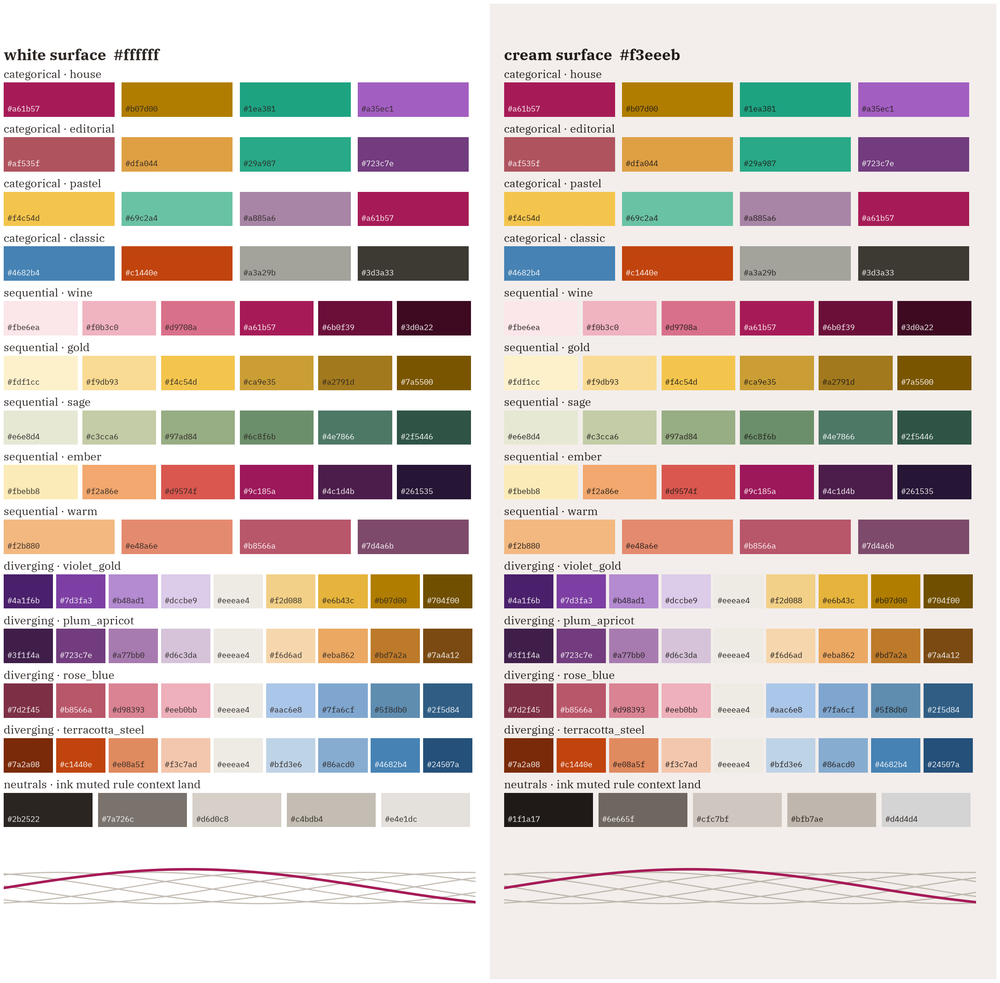

## Contents

| file | what |
|---|---|
| `STYLE_GUIDE.md` | the design spec and the reasons behind each rule |
| `chartstyle.py` | `set_style()`, surface tokens (`theme()`), palettes (`CATEGORICAL`, `SEQUENTIAL`, `DIVERGING`, `palette()`, `cmap()`), sizes (`figsize()`, `MEDIA`), annotation helpers, chart shapes, `save_fig()`, `compose_poster()` |
| `palette_check.py` | computed validation of every palette (lightness, chroma, CVD, contrast, ramp monotonicity) |
| `gallery.py` | renders `gallery/*.png`: one example per recipe; copy-paste starting points |
| `fonts/` | IBM Plex Sans / Serif (incl. italics) / Mono `.ttf` (SIL OFL), registered at runtime |

## Quick start

```python
import matplotlib.pyplot as plt
from modules.dataviz_style import chartstyle as cs

cs.set_style(bg="white", medium="paper")      # journal figure (the default)
# cs.set_style(bg="cream", medium="web")      # personal site with a cream page

fig, ax = plt.subplots(figsize=cs.figsize("onehalf"))
cs.context_lines(ax, years, others)           # many light lines
ax.plot(years, focus, color=cs.WINE)          # the story
cs.direct_labels(ax, [(years[-1], focus[-1], "Czechia", cs.WINE)], dots=True)
cs.gridline_labels(ax, unit="index (2015 = 100)")
cs.save_fig(fig, "reports/figures/cooling")   # paper -> .pdf .svg .png ; web -> .svg
```

Standalone social image:

```python
fig = cs.compose_poster([lambda ax: plot_cooling(df, ax=ax)],
                        title="Turn the AC on",
                        subtitle="Household cooling doubled since 2015",
                        byline="michaltobiasdobes.cz", source="Eurostat (2024)")
cs.save_fig(fig, "reports/figures/poster_cooling", formats="png")
```

Commands:

```bash
python -m modules.dataviz_style.palette_check     # validate all palettes on white and cream
python -m modules.dataviz_style.gallery           # re-render the specimen images
```

## Gallery

| | |
|---|---|
| 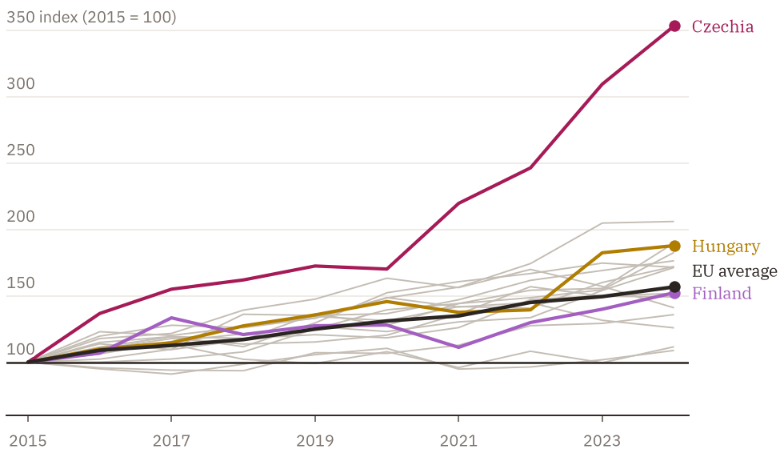 highlight + context, end dots, gridline labels | 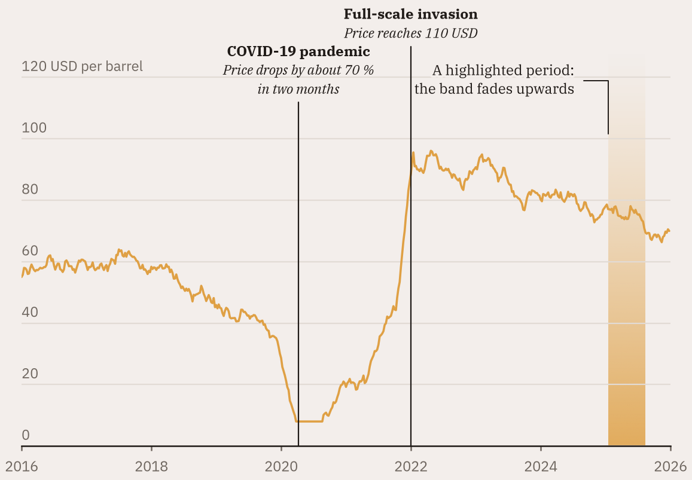 event lines, fading highlight span, callout (cream) |
| 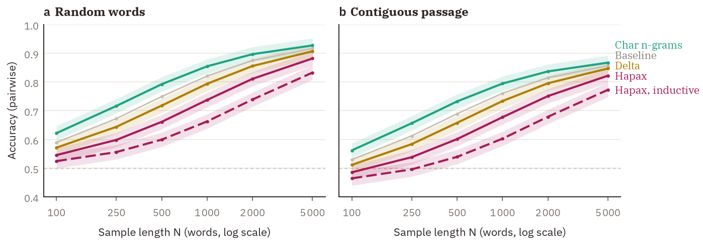 paper small multiples, CI bands, panel letters | 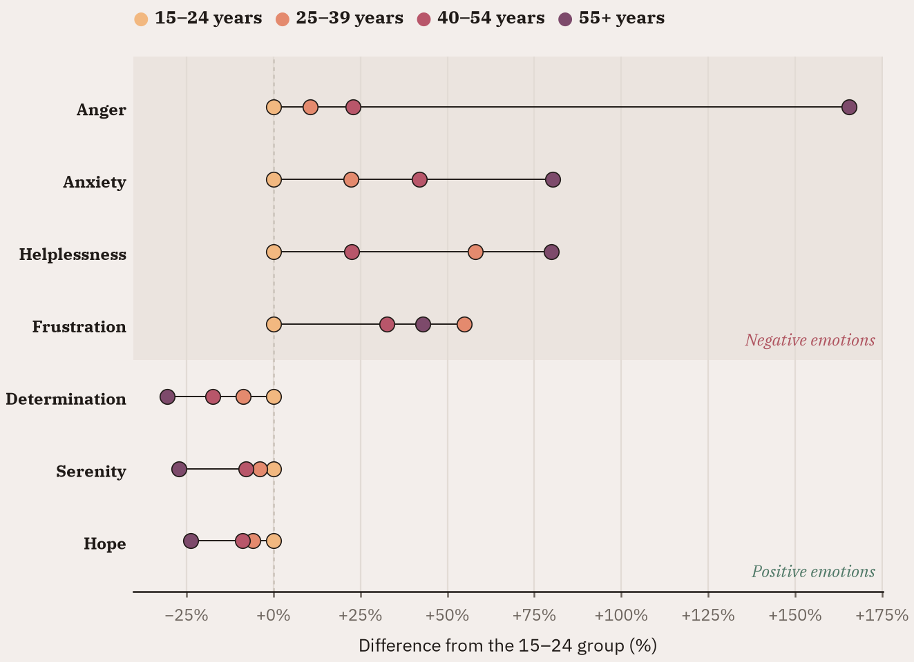 dot strip, warm ordinal ramp, legend in a sentence |
| 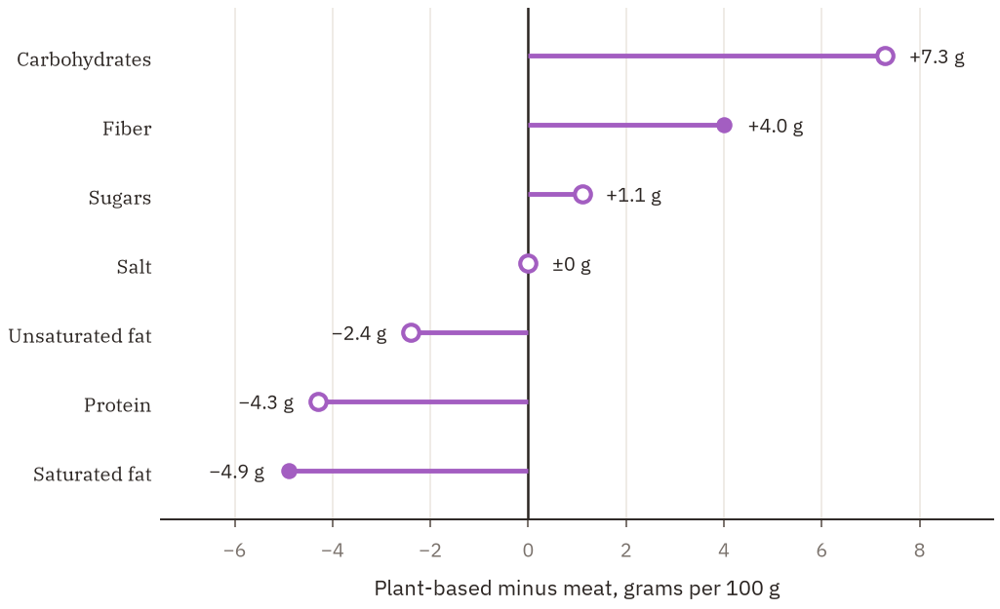 diverging lollipop, open ring = not notable | 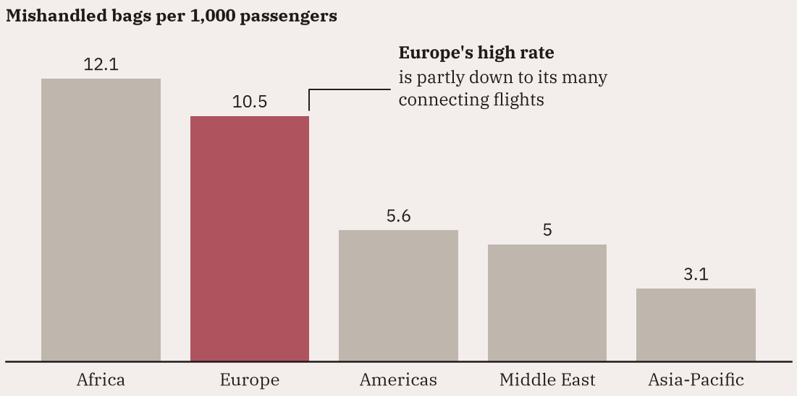 one accented bar, values on bars |
| 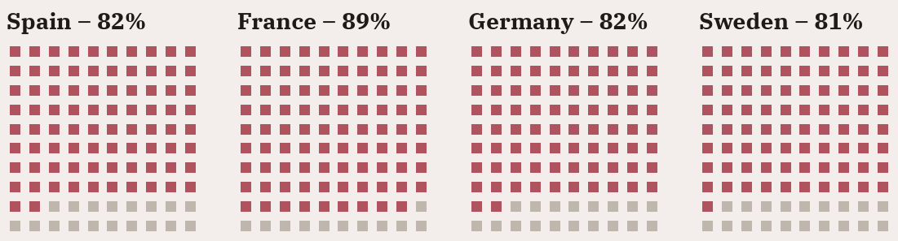 waffle small multiples | 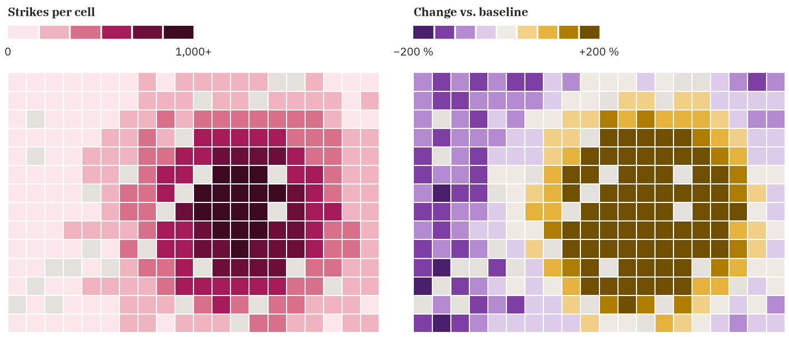 stepped sequential / diverging grid maps |
| 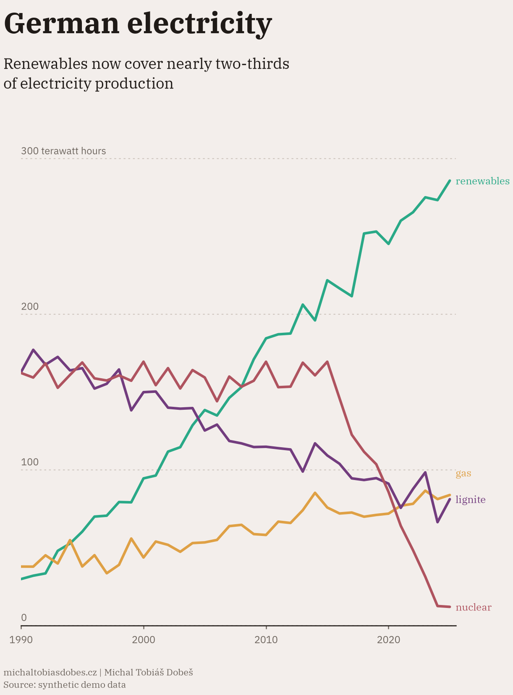 poster (4:5, cream) | 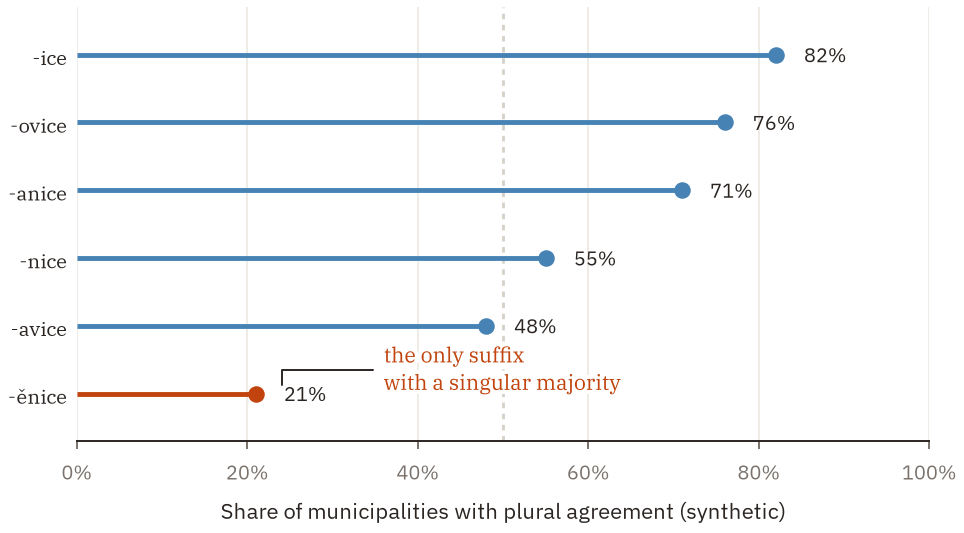 conservative `classic` palette: steel + reserved terracotta |

## Pulling just this module into an existing project

```bash
git clone --no-checkout https://github.com/Dobes-Michal-Tobias/research-template.git tmp_template
cd tmp_template
git sparse-checkout init --cone
git sparse-checkout set modules/dataviz_style
git checkout
```

Copy `modules/dataviz_style/` (code + fonts) into the project under the same
path, so `from modules.dataviz_style import chartstyle` works. The gallery
PNGs can be left out.

## Migrating from the old version (steelblue / terracotta)

`PRIMARY_COLOR`, `ACCENT_COLOR`, `NEUTRAL_COLOR`, `CATEGORICAL_PALETTE` and
`GRID_ON_*` are gone; steel blue and terracotta now live in the `classic`
palette (`STEEL`, `TERRACOTTA`, `SLATE_GRAY`, `CHARCOAL`, see STYLE_GUIDE §3.2);
`set_style()` gained `medium=`; `save_fig()` returns a list of paths and
picks formats by medium. `INK_COLOR`, `MUTED_COLOR`, `BG_WHITE`, `BG_CREAM`,
`BAR_WIDTH`, `hlollipop`, `lollipop_height`, `share_lollipop`,
`binned_logistic`, `add_poster_titles` and `compose_poster` keep their
names. Projects that vendored the old module (HolidayCalc, GeoGram) keep
working with their own copy.
